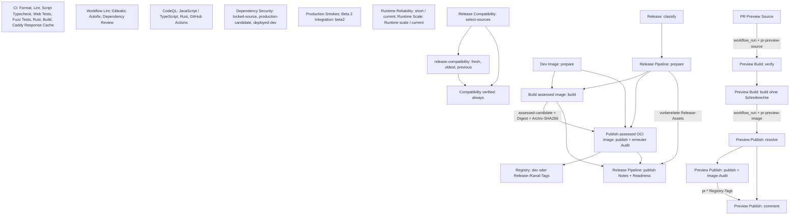

# Welche Workflows wofür zuständig sind

Für normale Änderungen prüfen **CI**, **Workflow Lint**, **Gitleaks**, **CodeQL**,
**Dependency Review**, **Deployed Dependency Security** und **Production Smokes**
den eigenen Code, seine Abhängigkeiten und die Integration der Appliance.
Geeignete PRs erhalten ein eigenes Docker-Preview-Image nach bestandener
Herkunfts- und Pflichtcheckprüfung. Ein Push auf `main`
veröffentlicht kein Dev-Image; **Dev Image** wird manuell gestartet.

Es gibt 20 Workflow-Dateien, darunter drei wiederverwendbare Bausteine für
Image-Build, Release und Veröffentlichung. GitHubs integrierte Dependabot-Automation erstellt
zusätzlich den Lauf **Dependency Graph**.

| Workflow                                                           | Startet bei                         | Aufgabe                                                                                                                                            |
| ------------------------------------------------------------------ | ----------------------------------- | -------------------------------------------------------------------------------------------------------------------------------------------------- |
| [CI](workflows/ci.yml)                                             | PR, Push, manuell                   | Format, Lint, Skript-Typprüfung, Web-/Fuzz-Tests, Rust und Produktionsbuild. Der Web-Build prüft auch die Web-Typen.                               |
| [autofix.ci](workflows/autofix.yml)                                | PR, Push                            | Bun-/Rust-Formatierung über die autofix.ci-App korrigieren; `.github` ist von Korrekturen ausgeschlossen.                                          |
| [Beta 2 Integration](workflows/beta2-integration.yml)              | PR, Push, manuell                   | Echte Web-/Controller-Abläufe mit PostgreSQL, Valkey und gepinntem Caddy prüfen.                                                                   |
| [Workflow Lint](workflows/workflow-lint.yml)                       | PR, Push, manuell                   | Actions/YAML mit actionlint und Automations-Shellskripte mit ShellCheck prüfen.                                                                    |
| [Gitleaks](workflows/gitleaks.yml)                                 | PR, Push, manuell                   | Neue Commits auf Geheimnisse prüfen; manuell auch die vollständige Historie.                                                                       |
| [CodeQL](workflows/codeql.yml)                                     | PR, Push, wöchentlich, manuell      | Eigenes JavaScript/TypeScript, Rust und GitHub Actions analysieren.                                                                                |
| [Dependency Review](workflows/dependency-review.yml)               | PR                                  | Neu eingeführte Abhängigkeiten ab Schweregrad „moderate“ prüfen.                                                                                   |
| [Deployed Dependency Security](workflows/dependency-security.yml)  | PR, Push, täglich, manuell          | Eigene vollständige Cargo-/Bun-Lockfiles, Produktionskandidat und aktuelles Dev-Image prüfen; Details unten.                                       |
| [Production Smokes](workflows/production-smokes.yml)               | PR, Push, manuell                   | Proxy-, Appliance-, Backup/Restore-, Drain-, ACME- und TLS-Integration prüfen. Drei gemeinsame Images werden einmal pro Lauf gebaut.               |
| [Release Compatibility](workflows/release-compatibility.yml)       | Betroffene PRs, jeder Push, manuell | Neuinstallation sowie Upgrades von ältester unterstützter und vorheriger veröffentlichter Version prüfen; Quellen werden unveränderlich aufgelöst. |
| [Runtime Reliability](workflows/runtime-reliability.yml)           | Betroffene PRs/Pushes, manuell      | Kurzes Profil mit aktuellem Build; lange Profile nur nach ausdrücklicher Auswahl.                                                                  |
| [Runtime Scale](workflows/runtime-scale.yml)                       | Nur manuell                         | Begrenzte Proxy-Last: standardmäßig 100 Hosts, vier Worker, drei Runden; Laufzeitlimit zehn Minuten.                                               |
| [PR Preview Source](workflows/pr-preview-source.yml)               | PR                                  | Exakte getestete Merge-SHA erfassen und den Herkunftsnachweis für das Preview speichern.                                                           |
| [PR Preview Build](workflows/pr-preview-build.yml)                 | Erfolgreicher Preview-Source-Lauf   | Getestete SHA und Pflichtchecks verifizieren, dann das eigene PR-Image als OCI-Archiv bauen.                                                       |
| [PR Preview Publish](workflows/pr-preview-publish.yml)             | Erfolgreicher Preview-Build         | Herkunft und Pflichtchecks erneut prüfen, eigene Image-Abhängigkeiten auditieren und das Preview veröffentlichen.                                  |
| [Dev Image](workflows/dev-image.yml)                               | Nur manuell                         | Dev-Kandidaten bauen, prüfen und über den Publisher als `:dev` veröffentlichen.                                                                    |
| [RentnerProxy Release](workflows/release.yml)                      | GitHub-Release wird veröffentlicht  | Alpha/Beta/Stable auswählen und die Release-Pipeline aufrufen.                                                                                     |
| [RentnerProxy Release Pipeline](workflows/release-pipeline.yml)    | Durch Release-Workflow              | Exakte Release-Identität prüfen, Image bauen/bewerten/veröffentlichen und Release Notes aktualisieren.                                             |
| [Build assessed image](workflows/build-assessed-image.yml)         | Durch Dev-/Release-Pipeline         | Exakte Quelle ohne Registry-Zugang als OCI-Daten bauen, auditieren und Archiv-SHA256 sowie Digest ausgeben.                                        |
| [Publish assessed OCI image](workflows/publish-assessed-image.yml) | Durch Dev-/Release-Pipeline         | Kandidat, Digest und eigene Abhängigkeiten unabhängig erneut prüfen, danach Registry-Tags veröffentlichen.                                         |

Push bedeutet `main`. Die meisten PR-Trigger gelten für alle Zielbranches;
Preview Source beschränkt sie auf `main`. „Betroffen“ bezeichnet die jeweiligen
`paths`-Filter. Compatibility und Reliability erfassen `core/`, `web/`, `docker/`,
`scripts/`, `.github/scripts/`, Build-Konfigurationen und Lockfiles. Dazu gehören
Migrationen, lokale Go-Module, Docker-Ignore-Dateien und transitiv importierte
Automatisierung. Jeder Main-Push erhält Compatibility-Evidenz für die exakte SHA,
auch bei Dokumentationsänderungen. Workflow-Cron-Zeiten sind UTC.

## Job- und Artefaktgraph

Kommas bezeichnen unabhängige Jobs, Pfeile die `needs`-Kanten oder beschriftete
Workflow-/Artefaktübergaben. Die Trigger stehen vollständig in der Tabelle oben.

Die Compatibility-Matrix wählt `fresh`, `oldest` und `previous` anhand der
veröffentlichten Readiness-Daten und der unterstützten Upgrade-Politik. Manuell
ist `all` voreingestellt; eine ausgewählte Teilmatrix erfüllt den abschließenden
Check `Compatibility verified` bewusst nicht.

| Erzeuger                   | Artefakt / Übergabe                                                                                               | Verbraucher und Grenze                                                                                                          |
| -------------------------- | ----------------------------------------------------------------------------------------------------------------- | ------------------------------------------------------------------------------------------------------------------------------- |
| CI / Rust                  | `rust-coverage-linux` (14 Tage)                                                                                   | Diagnose; keine Build-Freigabe für Publisher.                                                                                   |
| Dependency Security        | `source-dependency-advisory-evidence`, `production-advisory-evidence`, `deployed-dev-advisory-evidence` (30 Tage) | Nachweise für jeweils eigene Quelle, Kandidat oder Dev-Digest.                                                                  |
| Production Smokes          | Drei lokale Images mit Quell-SHA, Lauf und Image-Art                                                              | Nur Suiten desselben Jobs; immer laufbezogene Bereinigung.                                                                      |
| Reliability / Scale        | `runtime-reliability-current-<attempt>`, `runtime-scale-<attempt>` (30 Tage)                                      | Bereinigte JSON-Berichte.                                                                                                       |
| Preview Source             | `pr-preview-source` (2 Tage)                                                                                      | PR-Nummer und getestete Merge-SHA des konkreten Quelllaufs.                                                                     |
| Preview Build              | `pr-preview-image` (2 Tage)                                                                                       | OCI-Archiv und Metadaten; Publisher prüft Lauf/Versuch, Herkunft, Archiv-SHA256, Plattform und Digest.                          |
| Preview Publish            | `dependency-preview-evidence-<run>-<attempt>` (30 Tage)                                                           | Frischer eigener Image-Audit vor Registry-Zugang; Live-PR und Pflichtchecks werden erneut geprüft.                              |
| Build assessed image       | `assessed-candidate-<run>` (2 Tage), `dependency-build-evidence-<run>-<attempt>` (30 Tage)                        | Publisher lädt denselben Kandidaten, prüft Archiv-SHA256/Digest und auditiert erneut.                                           |
| Publish assessed image     | `dependency-publish-evidence-<run>-<attempt>` (30 Tage)                                                           | Veröffentlichungsnachweis für genau diesen OCI-Digest.                                                                          |
| Release Pipeline / prepare | `rentnerproxy-<channel>-release-<run>` (30 Tage)                                                                  | Notes-Job validiert vorbereitete Dateien; Readiness verlangt zusätzlich erfolgreiche CI und Compatibility der exakten Main-SHA. |

Normale Prüfungen und unprivilegierte Builds haben `contents: read`. CodeQL
ergänzt im Analysejob `security-events: write`. Preview-Verifikation liest
zusätzlich Actions, Checks und PRs. Nur Publisher erhalten `packages: write`;
nur der Preview-Kommentarjob erhält `pull-requests: write`. Release-Vorbereitung
liest Issues, der abschließende Release-Job schreibt Inhalte und liest Actions.
Wiederverwendbare Workflows und Aufrufer begrenzen Rechte pro Job. Checkout-
Zugangsdaten werden nicht persistiert. autofix.ci arbeitet über seine eigene App.

Preview-Builds teilen keine Publish-Caches. Dev und Release nutzen getrennte
Buildx-Scopes (`dev`, `release-<channel>`). Publisher führen keine Quellskripte
oder Images aus. Dev und Release sind jeweils serialisiert und werden nicht
abgebrochen. Normale CI-Läufe ersetzen ältere Läufe desselben PRs; Compatibility
und Reliability brechen nur ältere PR-Läufe ab.

## Umfang der Dependency-Prüfung

**Own dependency audit** prüft die vollständigen Cargo- und Bun-Lockfiles des
Quellstands. Alle RustSec-Befunde, Bun-Befunde ab „moderate“ und unvollständige
eigene Audits lassen den Check fehlschlagen. **Production image dependency audit**
prüft zusätzlich die eingebetteten Locks des konkreten Produktionskandidaten.

Debian, PostgreSQL, Valkey, Caddy, CrowdSec und deren Go-Module werden nicht mehr
separat auf Upstream-Advisories gescannt. Eigene Konfigurationen und die Einbindung
dieser Komponenten bleiben durch Code- und Integrationstests abgedeckt. Grün
bestätigt die eigenen Cargo-/Bun-Gates, keine Bewertung der gesamten Appliance.

Täglich laufen Quell-Lockfile-Audit und Dev-Image-Rescan. Manuell kommt der
Produktionskandidat hinzu. PRs und Main-Pushes prüfen ihre eigene Quelle und ihren
Kandidaten; sie starten keinen Dev-Rescan. Eigene
Dev-Befunde, ungültige Identitäten und fehlende eingebettete Locks bleiben Fehler.
Der tägliche Lauf baut keinen Kandidaten und scannt keine historischen Releases.

**Dev**, **Release** und **Preview Publish** auditieren vor Veröffentlichung die
eigenen Abhängigkeiten des konkreten Images. Nur ein frischer
`own-dependencies-approved`-Bericht für den exakten Quellstand und Digest erlaubt
die Veröffentlichung. Es gibt keine Advisory-Ausnahme für Dev-Images.

Der separate Bun-Audit-Workflow entfällt: Sein vollständiger Lockfile-Audit steckt
im gemeinsamen Dependency-Check. Scorecard, automatische PR-Labels, Duplikat-Triage
und die Conventional-Commit-Titelpflicht entfallen ebenfalls. Die Label-Zuordnung
für Release Notes bleibt erhalten.

## Erforderliche Checks

Die effektiven GitHub-Regeln für `main` wurden am 27. Oktober 2026 mit den
Workflow-Namen abgeglichen. Sie fordern eine aktuelle PR-Basis und diese 16 Checks:

- `Format`, `Lint`, `Script Typecheck`, `Web Tests`, `Rust`, `Build`
- `Workflow Lint`, `PR Preview Source`, `Dependency Review`, `Gitleaks`
- `CodeQL (JavaScript / TypeScript)`, `CodeQL (Rust)`, `CodeQL (GitHub Actions)`
- `Production Smokes`, `Own dependency audit`, `Production image dependency audit`

Die Preview-Prüfung liest die effektiven Regeln aus GitHub und überprüft die
Herkunft der Checks für die exakte getestete SHA. Diese Liste ist eine
Momentaufnahme; die GitHub-Regeln bleiben maßgeblich. Check-/Workflow-Namen werden
zusammen mit ihren Verbrauchern und Repository-Regeln geändert.

## Kurze und lange Laufzeittests

Reliability `short` dauert 120 Sekunden mit drei Iterationen; `long` 1.800 Sekunden
mit 120 Iterationen. Build/Einrichtung kommen hinzu. Normale PRs und Pushes sowie
die manuelle Voreinstellung wählen `short` mit aktuellem Build. Der automatische
Wochenlauf entfällt.

Lange Profile des aktuellen Builds bleiben ausdrücklich manuell
für Release-Vorbereitung oder eine konkrete Anforderung verfügbar. Runtime Scale
läuft nur manuell mit Zehn-Minuten-Limit; sein Job-Timeout von 30 Minuten ist kein
30-Minuten-Profil. Release Compatibility hat keinen Wochenplan; die Matrix
umfasst Neuinstallation und unveränderliche veröffentlichte Upgrade-Quellen
entsprechend der aktuellen Kompatibilitätspolitik.

Production Smokes prüft die aktuelle Appliance. Historische Upgrade-Läufe liegen
in Release Compatibility. Gemeinsame Images sind auf den validierten Lauf und
Commit beschränkt; einzelne Smoke-Befehle bauen weiterhin selbst.

## Versionspflege

Die Workflows verwenden Bun `1.4.4`, Rust `1.99.1`, actionlint `1.7.12` und
cargo-audit `0.22.2`. Der Cargo-Scanner wird als offizielles Linux-x86_64-Binary
derselben Version mit fest gepinnter SHA256 installiert; die Advisory-Datenbank
wird weiterhin frisch geladen. Format benötigt keine installierten
Projektabhängigkeiten: Bun bringt den Formatter mit, Rust liefert rustfmt. Externe Actions
bleiben auf vollständige Commit-SHAs gepinnt. Die CodeQL-Action verwendet ihre
eigene SemVer-Release; ein neueres `codeql-bundle-*`-Tag ist keine Action-Version.

Dependabot prüft routinemäßige Versionsupdates montags um 03:00 Uhr Europe/Berlin,
gruppiert Minor-/Patch-Updates und lässt Security-Updates aktiv; siehe
[dependabot.yml](dependabot.yml).

Docker-Hub-Images werden über Googles Cache `mirror.gcr.io` geladen, damit
gemeinsame Download-Limits der CI-Runner Builds nicht abbrechen. Die gepinnten
Digests wurden gegen die ursprünglichen Images geprüft; das gilt auch für das
Dockerfile-Frontend.

Für Skriptzuständigkeiten und vertrauenswürdige Checkouts siehe
[AUTOMATION.md](AUTOMATION.md).
