<p align="center">
  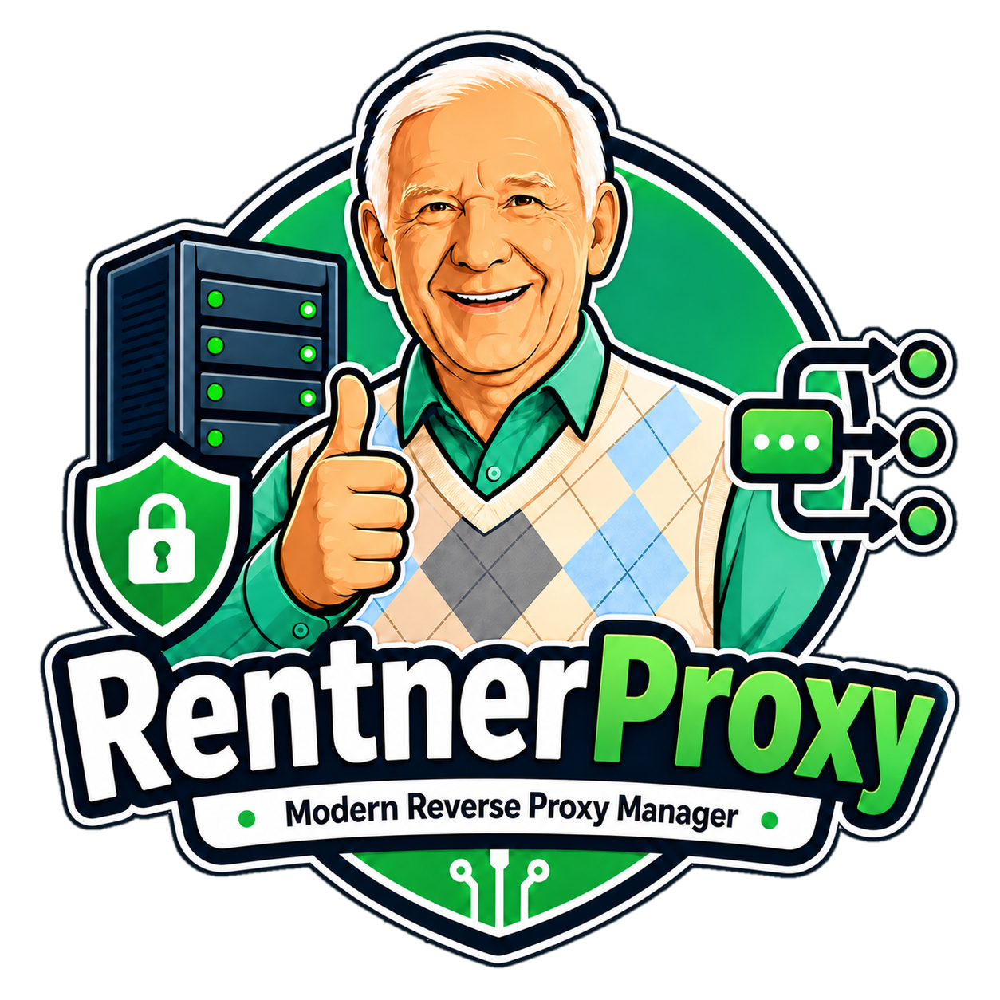
</p>

<h1 align="center">RentnerProxy</h1>

<p align="center">
  <strong>Modern self-hosted reverse proxy management powered by Caddy.</strong>
</p>

<p align="center">
  <a href="https://github.com/RentnerKev/RentnerProxy/actions/workflows/ci.yml"></a>
  <a href="https://github.com/RentnerKev/RentnerProxy/actions/workflows/codeql.yml"></a>
  <a href="https://www.bestpractices.dev/projects/14354"></a>
  <a href="https://github.com/RentnerKev/RentnerProxy/releases/tag/v1.0.0-beta.2"></a>
  <a href="./LICENSE"></a>
</p>

> [!IMPORTANT]
> Current public release: [v1.0.0-beta.2](https://github.com/RentnerKev/RentnerProxy/releases/tag/v1.0.0-beta.2).
> This is beta software: breaking changes are possible. Back up your data before upgrades.

## Features

- Proxy hosts and redirects with HTTP/2, HTTP/3, and WebSocket support.
- Duplicate proxy and redirect hosts into a draft with new domains, using existing creation, certificate and access-policy validation. Proxy copies inherit global HTTP settings; separate per-host Config overrides are not copied.
- Global quick search with Ctrl+K on Windows/Linux and Cmd+K on macOS, plus a mobile search control. Find authorized hosts, certificates, access policies and settings with bounded results and keyboard navigation.
- Automatic TLS via ACME (HTTP-01 or Cloudflare DNS-01), wildcard and imported certificates.
- Cloudflare DDNS for A and AAAA records, with shared DNS connections, scheduling, retries and recovery.
- Opt-in Docker discovery that manages proxy hosts from labeled containers.
- Email and webhook notifications with event subscriptions and delivery status.
- Release detection, update notifications and guided upgrades.
- Host tags, groups, filters and permission-aware bulk actions.
- Configurable Zstd/Gzip response compression, browser-cache rules and an optional bounded response cache for public assets.
- Access policies with Basic Auth, Forward Auth, and IP allow/deny rules; verified HTTPS upstreams.
- CrowdSec protection: managed or external Local API, optional community/Console connection, and a dedicated security dashboard.
- Users, roles, permissions, TOTP, passkeys, and audit logs.
- Personal accent colors and light/dark themes; login and public pages retain the default green.
- Live status and access logs; English, German, Spanish, French, Italian, Portuguese, Dutch, and Polish UI.
- Single-container appliance with Caddy, PostgreSQL, Valkey, and a Rust controller.

Manual and delegated DNS-01 are planned for [v1.0.0-beta.3](https://github.com/RentnerKev/RentnerProxy/milestone/9)
and are not part of Beta 2. The remaining implementation is tracked in
[#277](https://github.com/RentnerKev/RentnerProxy/issues/277).

## Installation

Requirements:

- `linux/amd64` host with Docker Engine and Docker Compose.
- Free ports `80/tcp`, `443/tcp`, and `443/udp`.
- HTTPS management origin and SMTP credentials.

The example pins the Beta 2 image with `RENTNERPROXY_IMAGE`:
`ghcr.io/rentnerkev/rentnerproxy:v1.0.0-beta.2`.

Save this as `docker-compose.yml` (or use the [repository file](docker-compose.yml)):

```yaml
services:
    rentnerproxy:
        image: ${RENTNERPROXY_IMAGE:?Set RENTNERPROXY_IMAGE to a Valkey-based RentnerProxy image}
        environment:
            RENTNERPROXY_PUBLIC_ORIGIN: ${RENTNERPROXY_PUBLIC_ORIGIN:?Set RENTNERPROXY_PUBLIC_ORIGIN}
            RENTNERPROXY_PROXY_TRUSTED_PROXY_CIDRS: ${RENTNERPROXY_PROXY_TRUSTED_PROXY_CIDRS:-}
            SMTP_FROM: ${SMTP_FROM:?Set SMTP_FROM}
            SMTP_HOST: ${SMTP_HOST:?Set SMTP_HOST}
            SMTP_PASSWORD: ${SMTP_PASSWORD:?Set SMTP_PASSWORD}
            SMTP_PORT: ${SMTP_PORT:-587}
            SMTP_SECURE: ${SMTP_SECURE:-false}
            SMTP_USER: ${SMTP_USER:?Set SMTP_USER}
        ports:
            - '80:8080'
            - '127.0.0.1:81:3000'
            - '443:8443/tcp'
            - '443:8443/udp'
        restart: unless-stopped
        stop_grace_period: 30s
        volumes:
            - rentnerproxy:/var/lib/rentnerproxy

volumes:
    rentnerproxy:
```

Create `.env` beside it (see also [`.env.production.example`](.env.production.example)):

```dotenv
RENTNERPROXY_IMAGE=ghcr.io/rentnerkev/rentnerproxy:v1.0.0-beta.2
RENTNERPROXY_PUBLIC_ORIGIN=https://management.example.com
SMTP_HOST=smtp.example.com
SMTP_PORT=587
SMTP_SECURE=false
SMTP_USER=rentnerproxy@example.com
SMTP_PASSWORD=replace-me
SMTP_FROM=RentnerProxy <rentnerproxy@example.com>

# Optional: only the direct IP/CIDR of a trusted proxy in front of RentnerProxy.
# RENTNERPROXY_PROXY_TRUSTED_PROXY_CIDRS=192.0.2.10/32
```

To build from this checkout instead, run the following command and set
`RENTNERPROXY_IMAGE=rentnerproxy:local` in your Compose `.env`:

```bash
docker build --file docker/production/Dockerfile --tag rentnerproxy:local .
```

Start the appliance:

```bash
docker compose config
docker compose up -d
```

- Complete first-owner setup at `http://localhost:81`. For a remote host, keep port 81 private and use `ssh -L 8181:127.0.0.1:81 user@server`.
- Use the configured HTTPS `RENTNERPROXY_PUBLIC_ORIGIN` for normal access, email links, and passkeys.
- Application data lives in the persistent `rentnerproxy` Docker volume.

During restart or recreation, the controller recovers supported persisted proxy snapshots after
preparing CrowdSec, before waiting for PostgreSQL and Valkey. Existing HTTP/HTTPS routes can serve
while those independent services recover; management readiness still waits for the database,
cache and migrations. Fresh installations and unsupported snapshot versions use the safe default
site until the application reconciles their configuration. Replacing a single appliance container
still interrupts its connections and listeners; this startup order does not provide zero downtime.

## Upgrade

From Beta 2 onward, `v1.0.0-beta.1` is the minimum supported upgrade source.
Back up the installation with its current release's tools before changing the image.
Keep the persistent volume, encryption material and deployment configuration.

Alpha installations must first upgrade to the exact image
`ghcr.io/rentnerkev/rentnerproxy:v1.0.0-beta.1`. Complete startup and configuration
reconciliation, verify hosts and certificates, and create a new v4 backup before
upgrading to Beta 2 or a later supported beta. Use the pinned Beta 1 tag for the
intermediate step; `:beta` follows the newest beta and skips it.

Alpha v3 backups must first be restored with Beta 1 and that release's restore
tools, then backed up again as v4. Direct Alpha upgrades, direct v3 restores and
the old environment-file secret import are no longer supported in Beta 2.

See [upgrade, backup and rollback instructions](docs/operations.md#upgrades).

## Docker images

RentnerProxy images are published to `ghcr.io/rentnerkev/rentnerproxy`.

| Tag       | Channel                                                                        |
| --------- | ------------------------------------------------------------------------------ |
| `:latest` | Latest stable release                                                          |
| `:beta`   | Latest beta release                                                            |
| `:alpha`  | Latest alpha release                                                           |
| `:dev`    | Development build from `main` for testing new and potentially unstable changes |

Every release is also published with its exact version tag. Use an exact tag when you want to pin
a specific release, for example:

```text
ghcr.io/rentnerkev/rentnerproxy:v1.0.0-beta.2
ghcr.io/rentnerkev/rentnerproxy:v1.0.0-beta.1
ghcr.io/rentnerkev/rentnerproxy:v1.0.0-alpha.6
```

Moving channel tags such as `:latest`, `:beta`, and `:alpha` always follow the newest release
in that channel. `:dev` is not a release and may change at any time.

## Screenshots

Desktop UI in dark and light mode: hosts, certificates, DDNS, security and notifications.
Screenshots include example records and labeled demo metrics. Click a thumbnail to view the full-size image.

<details open>
<summary><strong>Dark mode</strong></summary>

<table>
  <tr>
    <td align="center"><a href="./screenshots/proxy-hosts-dark-v2.webp">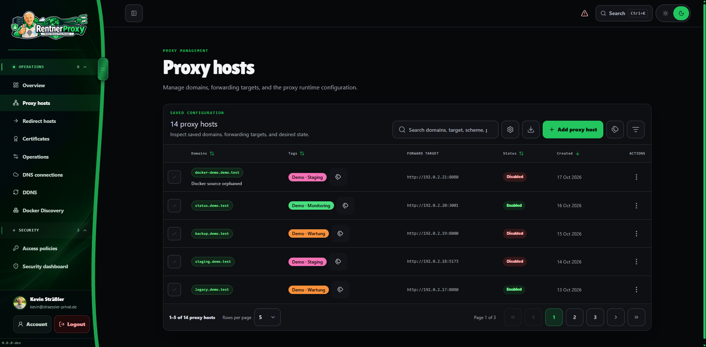</a><br>Proxy hosts</td>
    <td align="center"><a href="./screenshots/certificates-dark.webp">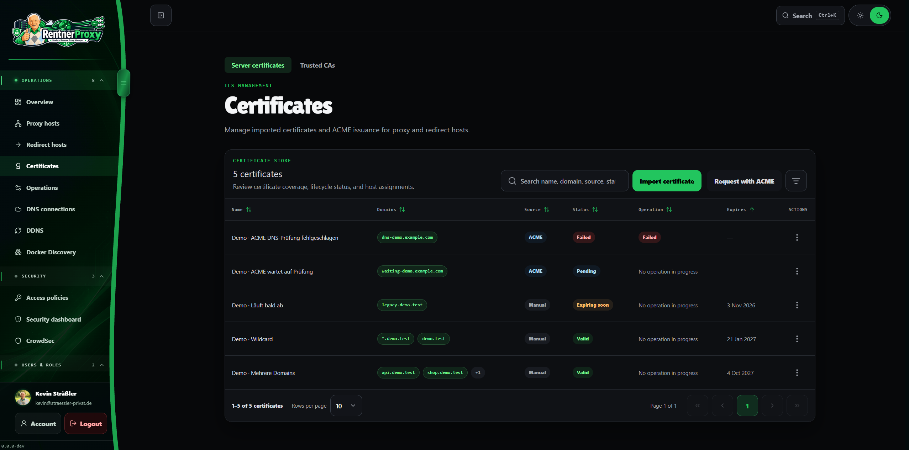</a><br>TLS certificates</td>
  </tr>
  <tr>
    <td align="center"><a href="./screenshots/ddns-dark.webp">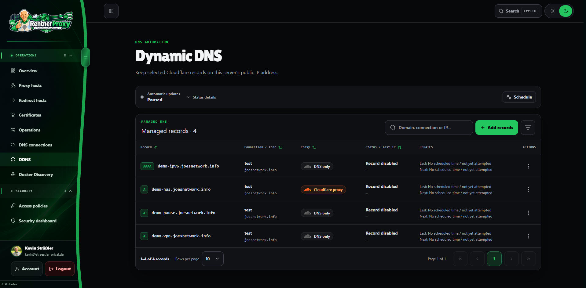</a><br>Cloudflare DDNS</td>
    <td align="center"><a href="./screenshots/security-dashboard-dark.webp">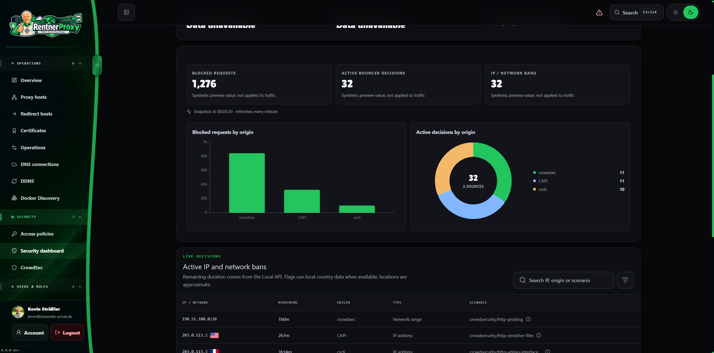</a><br>Security dashboard</td>
  </tr>
  <tr>
    <td align="center" colspan="2"><a href="./screenshots/notifications-dark.webp">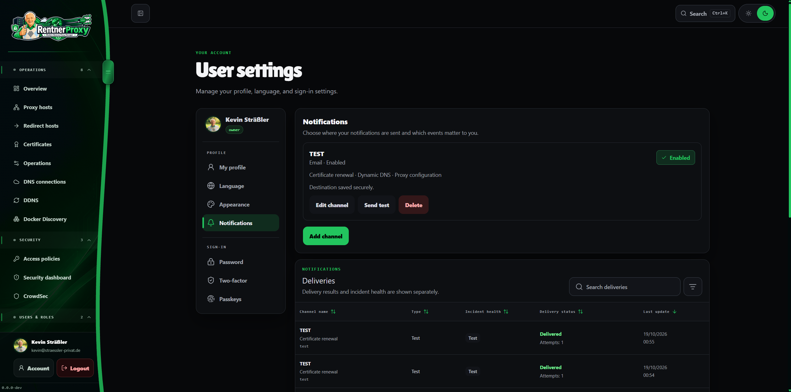</a><br>Notifications</td>
  </tr>
</table>

</details>

<details>
<summary><strong>Light mode</strong></summary>

<table>
  <tr>
    <td align="center"><a href="./screenshots/proxy-hosts-light.webp">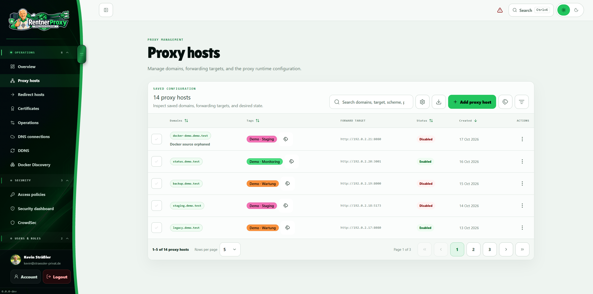</a><br>Proxy hosts</td>
    <td align="center"><a href="./screenshots/certificates-light.webp">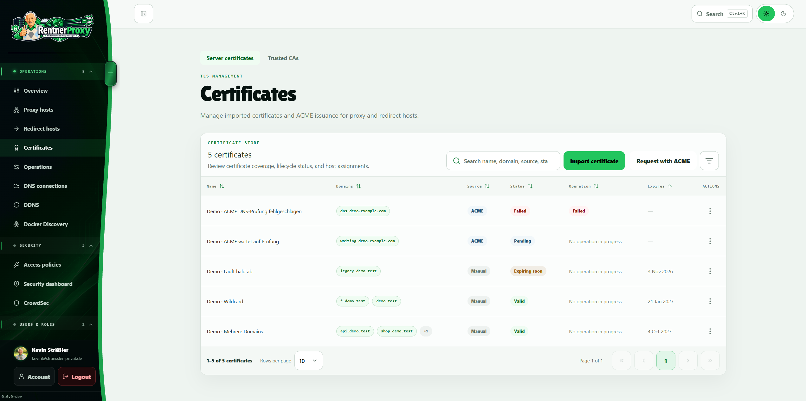</a><br>TLS certificates</td>
  </tr>
  <tr>
    <td align="center"><a href="./screenshots/ddns-light.webp">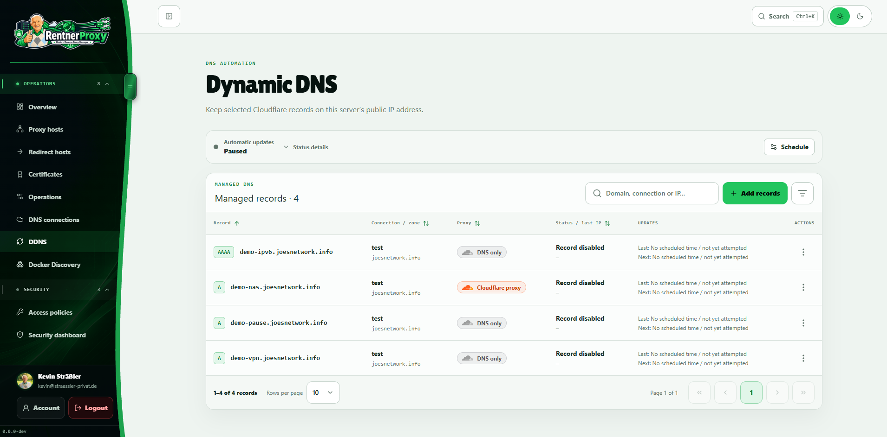</a><br>Cloudflare DDNS</td>
    <td align="center"><a href="./screenshots/redirect-hosts-light.webp">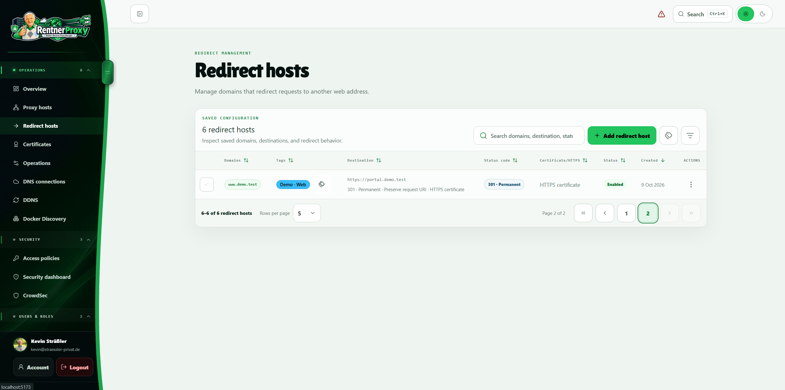</a><br>Redirect hosts</td>
  </tr>
  <tr>
    <td align="center" colspan="2"><a href="./screenshots/notifications-light.webp">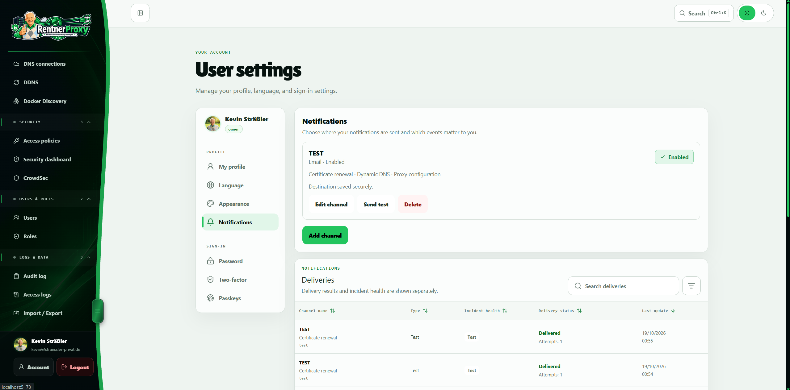</a><br>Notifications</td>
  </tr>
</table>

</details>

## More information

- [Architecture](docs/architecture.md) · [Security policy](SECURITY.md) · [Assurance case](docs/security/assurance-case.md)
- [Operations](docs/operations.md) · [Runtime checks](docs/runtime-checks.md)
- [Contributing](.github/CONTRIBUTING.md) · [Report a bug](https://github.com/RentnerKev/RentnerProxy/issues/new/choose)

Licensed under [MIT](LICENSE).
